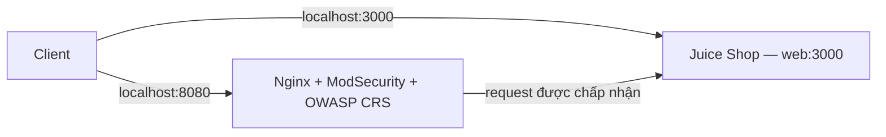

# Bài 1 — WAF trên Nginx

Lab theo mục 5 của [tài liệu bài giảng](Tong_hop_bai_giang_Thiet_ke_cho_bao_mat.md), slide 17–18. Bài 1 dựng OWASP Juice Shop phía sau Nginx + ModSecurity + OWASP CRS. Bài 2 kiểm thử đăng nhập được chuẩn bị trong [test plan](docs/test-plan.md), trạng thái ban đầu **NOT RUN**.

## Kiến trúc và phạm vi

| Thành phần | Vai trò |
|---|---|
| `web` / OWASP Juice Shop | Backend cố ý có lỗ hổng, phục vụ lab |
| `waf` / Nginx | Nhận HTTP, reverse proxy đến backend |
| ModSecurity | Kiểm tra request và thực thi hành động theo luật |
| OWASP CRS | Bộ luật phát hiện các dấu hiệu tấn công |
| Docker Compose | Khởi chạy và kết nối hai service bằng mạng nội bộ |

Đây là ví dụ **Gatekeeper** tại cổng vào và **Gateway Offloading** cho việc kiểm tra request. Cổng 3000 giữ lại để đối chứng với đường qua WAF ở Bài 2. Cả hai cổng host đều bind `127.0.0.1`: **điều chỉnh phục vụ lab so với slide**, vốn dùng `3000:3000` và `8080:8080` không chỉ định địa chỉ host. Truy cập bằng HTTP trên máy này; backend nội bộ dùng tên service `web`.

Phạm vi Bài 1 gồm Compose, readiness, cấu hình và log thực tế. JWT, MinIO, Sidecar, rate limiting và kiểm thử tấn công không thuộc phần triển khai này.

## Điều kiện chạy

- Docker Engine chạy Linux containers; có Docker Compose v2.
- Windows PowerShell 5.1 hoặc PowerShell 7 cho script readiness.
- Cổng TCP 3000 và 8080 còn trống; có mạng để tải image lần đầu.
- Chạy lệnh ở thư mục repository.

## Tiêu chí nghiệm thu

| ID | Điều cần chứng minh |
|---|---|
| L1-01 | `docker compose config --quiet` thành công |
| L1-02 | Hai service `web`, `waf` đang chạy với mapping localhost đúng |
| L1-03 | HTTP 200 và HTML Juice Shop qua cả cổng 3000 và 8080; asset giao diện tải được |
| L1-04 | Nginx nạp module ModSecurity, bật kiểm tra; engine `On`, blocking paranoia `1`, CRS được include |
| L1-05 | Proxy thực tế đến `http://web:3000`; đọc được startup/access log WAF |
| L1-06 | Có phiên bản Docker/Compose, image tag/digest và bằng chứng thật trong `evidence/lab1` |

Các tiêu chí trên không chứng minh khả năng chặn SQL Injection. TC01–TC04 thuộc Bài 2 và được theo dõi riêng.

## Tiến độ commit dự kiến

1. `docs(lab): define WAF scope and acceptance criteria`
2. `feat(lab1): add Juice Shop backend`
3. `feat(lab1): add Nginx ModSecurity CRS gateway`
4. `chore(lab1): add readiness checks and runtime evidence`

Hướng dẫn vận hành và kết quả thực tế được bổ sung theo tiến độ triển khai.

## Nguồn đối chiếu

- [Image OWASP CRS chính thức: biến môi trường, healthcheck, logging](https://github.com/coreruleset/modsecurity-crs-docker)
- [Juice Shop: chạy bằng Docker](https://github.com/juice-shop/juice-shop#docker-container)
