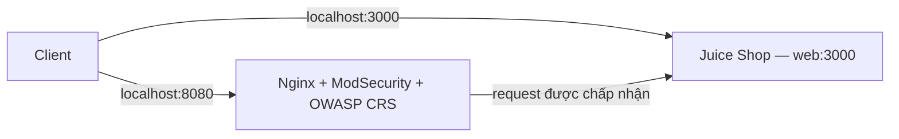

# Bài 1–2 — WAF trên Nginx

**Bài 2 đã thực hiện ngày 26/10/2026:** TC01–TC04 PASS ở lượt chạy cuối, có bằng chứng HTTP, audit log đã lọc và ảnh Edge thật. Xem [báo cáo Bài 2](docs/lab-report.md) để chạy script, demo Network và xem giới hạn GUI (`/whoami` bị chặn nhầm). Các ghi chú NOT RUN trong phần lịch sử Bài 1 bên dưới mô tả thời điểm bàn giao Bài 1, không phải trạng thái Bài 2 hiện tại.

```powershell
powershell.exe -NoProfile -ExecutionPolicy Bypass -File scripts/Test-Waf.ps1 -Test All
# Chọn riêng bằng -Test TC01, TC02, TC03 hoặc TC04.
```

Lab theo mục 5 của [tài liệu bài giảng](Tong_hop_bai_giang_Thiet_ke_cho_bao_mat.md), slide 17–18. Bài 1 dựng OWASP Juice Shop phía sau Nginx + ModSecurity + OWASP CRS. Bài 2 kiểm thử đăng nhập được chuẩn bị trong [test plan](docs/test-plan.md), trạng thái ban đầu **NOT RUN**.

## Kiến trúc và phạm vi



| Thành phần | Vai trò |
|---|---|
| `web` / OWASP Juice Shop | Backend cố ý có lỗ hổng, phục vụ lab |
| `waf` / Nginx | Nhận HTTP, reverse proxy đến backend |
| ModSecurity | Kiểm tra request và thực thi hành động theo luật |
| OWASP CRS | Bộ luật phát hiện các dấu hiệu tấn công |
| Docker Compose | Khởi chạy và kết nối hai service bằng mạng nội bộ |

Đây là ví dụ **Gatekeeper** tại cổng vào và **Gateway Offloading** cho việc kiểm tra request. Cổng 3000 giữ lại để đối chứng với đường qua WAF ở Bài 2. Cả hai cổng host đều bind `127.0.0.1`: **điều chỉnh phục vụ lab so với slide**, vốn dùng `3000:3000` và `8080:8080` không chỉ định địa chỉ host. Truy cập bằng HTTP trên máy này; backend nội bộ dùng tên service `web`.

Phạm vi Bài 1 gồm Compose, readiness, cấu hình và log thực tế. JWT, MinIO, Sidecar, rate limiting và kiểm thử tấn công không thuộc phần triển khai này.

## Điều kiện chạy

- Docker Engine chạy Linux containers; có Docker Compose v2.
- Windows PowerShell 5.1 hoặc PowerShell 7 cho script readiness.
- Cổng TCP 3000 và 8080 còn trống; có mạng để tải image lần đầu.
- Chạy lệnh ở thư mục repository.

## Tiêu chí nghiệm thu

| ID | Điều cần chứng minh |
|---|---|
| L1-01 | `docker compose config --quiet` thành công |
| L1-02 | Hai service `web`, `waf` đang chạy với mapping localhost đúng |
| L1-03 | HTTP 200 và HTML Juice Shop qua cả cổng 3000 và 8080; asset giao diện tải được |
| L1-04 | Nginx nạp module ModSecurity, bật kiểm tra; engine `On`, blocking paranoia `1`, CRS được include |
| L1-05 | Proxy thực tế đến `http://web:3000`; đọc được startup/access log WAF |
| L1-06 | Có phiên bản Docker/Compose, image tag/digest và bằng chứng thật trong `evidence/lab1` |

Các tiêu chí trên không chứng minh khả năng chặn SQL Injection. TC01–TC04 thuộc Bài 2 và được theo dõi riêng.

## Tiến độ commit dự kiến

1. `docs(lab): define WAF scope and acceptance criteria`
2. `feat(lab1): add Juice Shop backend`
3. `feat(lab1): add Nginx ModSecurity CRS gateway`
4. `chore(lab1): add readiness checks and runtime evidence`

## Chạy riêng backend

```powershell
docker compose config --quiet
docker compose up -d web
Invoke-WebRequest -UseBasicParsing http://localhost:3000
docker compose logs --tail 30 web
```

Mở `http://localhost:3000` để xem Juice Shop. Image backend được khóa bằng digest trong Compose; nhãn `latest` chỉ thể hiện tag nguồn đã tải. Phiên bản thực tế và kết quả HTTP được ghi trong `evidence/lab1/backend-check.json`.

## Chạy WAF

```powershell
docker compose pull
docker compose config --quiet
docker compose up -d
powershell.exe -NoProfile -File .\scripts\Wait-LabReady.ps1 -TimeoutSeconds 120
docker compose ps
docker compose logs --tail 50 waf
```

Nếu chính sách PowerShell trên máy chặn script chưa ký, có thể chạy riêng tiến trình: `powershell.exe -NoProfile -ExecutionPolicy Bypass -File .\scripts\Wait-LabReady.ps1 -TimeoutSeconds 120`. Tham số này không sửa execution policy toàn máy.

Mở `http://localhost:8080` để truy cập Juice Shop qua WAF. `depends_on` giúp khởi động backend trước WAF nhưng không bảo đảm backend đã sẵn sàng; cần đợi HTTP thực tế.

| Biến | Giá trị lab | Ý nghĩa |
|---|---|---|
| `BACKEND` | `http://web:3000` | Địa chỉ backend trên mạng Compose |
| `MODSEC_RULE_ENGINE` | `On` | Bật kiểm tra và chặn theo luật; `DetectionOnly` chỉ phát hiện/ghi log |
| `BLOCKING_PARANOIA` | `1` | Mức CRS cơ bản; mức 1–4 cao hơn có thể tăng chặn nhầm |

Image WAF cũng được khóa digest. Lab dùng cấu hình Nginx/ModSecurity/CRS có sẵn trong image, không mount luật tùy chỉnh. Cấu hình được sinh từ biến môi trường khi container khởi động; dùng `docker compose up -d --force-recreate waf` sau khi cần tái tạo cấu hình.

Log được đọc qua `docker compose logs waf`. Với digest đang dùng, access log trỏ tới stdout, error log trỏ tới stderr; audit log là JSON, `RelevantOnly`, `Serial`, đích `/dev/stdout`. Request thành công không khớp luật có thể chỉ có access log. Các thông tin này được kiểm tra trực tiếp trong [bằng chứng cấu hình](evidence/lab1/waf-config.txt).

Script readiness dùng một deadline tổng, mỗi request tối đa 5 giây hoặc thời gian còn lại; mặc định thử lại sau 2 giây. Script bỏ qua proxy của máy, không đi theo redirect và chỉ chấp nhận HTTP 200, Content-Type HTML, tiêu đề Juice Shop và thẻ `app-root` trên cả hai đường truy cập. Exit code `0` là đạt; `1` là chưa sẵn sàng hoặc sai nội dung. Script chỉ đọc HTML; phần render trình duyệt được kiểm tra riêng.

```powershell
# PowerShell 7 cũng có thể dùng:
pwsh -NoProfile -File .\scripts\Wait-LabReady.ps1 -TimeoutSeconds 120

# Dùng IPv4 trực tiếp nếu localhost trên máy phân giải IPv6 chậm:
powershell.exe -NoProfile -File .\scripts\Wait-LabReady.ps1 -WebUrl http://127.0.0.1:3000/ -WafUrl http://127.0.0.1:8080/
```

## Dừng và khởi động lại

```powershell
# Dừng container, giữ lại trạng thái hiện tại:
docker compose stop
docker compose start
powershell.exe -NoProfile -File .\scripts\Wait-LabReady.ps1

# Dỡ container và mạng lab:
docker compose down
```

Lab không gắn volume dữ liệu Juice Shop; `down` hoặc tái tạo backend làm mất trạng thái thay đổi trong container. Image được giữ lại trên máy. Để đổi phiên bản, thay digest có chủ đích, chạy lại kiểm tra và cập nhật bằng chứng; `pull` với digest hiện tại không tự nâng cấp sang bản mới của tag.

**Xung đột đã xử lý trên máy này:** dịch vụ Apache `PEMHTTPD-x64` của EDB PEM chiếm cổng 8080. Người dùng cho phép và đã dừng dịch vụ bằng PowerShell quản trị; startup type không bị thay đổi. Dịch vụ hiện vẫn dừng để WAF sử dụng cổng 8080. Khi muốn dùng lại Apache: chạy `docker compose down`, sau đó mở PowerShell quản trị và chạy `Start-Service -Name PEMHTTPD-x64`. Trước khi chạy lab lần sau, có thể cần `Stop-Service -Name PEMHTTPD-x64` trong PowerShell quản trị.

## Kiểm tra cấu hình thực tế

```powershell
docker compose exec -T waf nginx -T
docker compose exec -T waf cat /etc/modsecurity.d/setup.conf
docker compose exec -T waf cat /etc/modsecurity.d/modsecurity.conf
docker compose exec -T waf cat /opt/owasp-crs/crs-setup.conf
docker compose logs --no-color --tail 100 waf
```

Trong output cần thấy `load_module ...ngx_http_modsecurity_module.so`, `modsecurity on`, `proxy_pass http://web:3000`, `SecRuleEngine On`, include bộ luật CRS và action `900000` đặt `blocking_paranoia_level=1`. Đây là các đường dẫn đã xác nhận trên image khóa trong Compose.

## Kết quả Bài 1

Kiểm tra ngày **26/10/2026, Asia/Bangkok (UTC+07:00)**: cả hai service chạy; WAF có health `healthy`; cả hai cổng trả HTML Juice Shop và render được trang sản phẩm trong Edge headless. Tám asset JS/CSS được tham chiếu trong HTML tải HTTP 200, có hash giống nhau giữa hai cổng.

| Thành phần | Phiên bản thực tế |
|---|---|
| Docker Client / Engine | 28.3.0 / 28.3.0, Linux/amd64 |
| Docker Compose | v2.38.1-desktop.1 |
| Windows PowerShell dùng kiểm tra | 5.1.26100.9711 |
| Juice Shop | 20.3.0 |
| Nginx / ModSecurity / connector | 1.30.6 / 3.0.17 / 1.0.4 |
| OWASP CRS | 4.30.0; Nginx báo nạp 855 luật |

Digest đầy đủ nằm trong `docker-compose.yml` và [runtime.json](evidence/lab1/runtime.json). [Danh mục bằng chứng và kết quả nghiệm thu](evidence/lab1/README.md) có ảnh hai giao diện, kết quả HTTP/asset, cấu hình và log. TC01–TC04 vẫn **NOT RUN** theo phạm vi Bài 2.

**Giới hạn đã quan sát:** cấu hình CRS mặc định chặn POST Socket.IO có Content-Type `text/plain` bằng `920420`, sau đó `949110` trả 403. Trang sản phẩm vẫn render; chức năng realtime có thể bị ảnh hưởng. Lab giữ cấu hình nền tảng; chưa tinh chỉnh policy cho Socket.IO. Chi tiết đã loại cookie và session ID nằm trong [browser-observation.json](evidence/lab1/browser-observation.json). Hiện tượng này không phải bằng chứng cho TC02/TC04.

## Xử lý lỗi thường gặp

| Hiện tượng | Kiểm tra / xử lý |
|---|---|
| Không kết nối được Docker daemon | Mở Docker Desktop, chọn Linux containers; chạy `docker version` trước |
| Port unavailable / bind forbidden | Dùng `Get-NetTCPConnection -State Listen -LocalPort 3000,8080`; xác định dịch vụ đang chiếm cổng. Với máy này xem hướng dẫn `PEMHTTPD-x64` ở trên |
| WAF 502 hoặc readiness timeout | Đọc `docker compose logs --tail 50 web waf`, kiểm tra `BACKEND`, đợi backend khởi động. Chỉ tăng timeout khi backend vẫn đang khởi tạo |
| HTTP 200 nhưng readiness báo sai trang | Đang gặp trang khác hoặc `/healthz`; kiểm tra nội dung, mapping và process chiếm cổng. `/healthz` chỉ xác nhận Nginx sống |
| WAF healthy nhưng app không vào được | Chạy readiness cả hai cổng; healthcheck có sẵn của WAF không chứng minh backend phục vụ được |
| Cảnh báo `ssl_stapling` / issuer certificate | Image tạo sẵn cấu hình HTTPS nội bộ với chứng chỉ tự ký; lab chỉ publish HTTP 8080. Kiểm tra `nginx -T` vẫn exit 0 |
| Log có `920350` khi dùng `127.0.0.1` | CRS cảnh báo Host dạng IP số; đây chưa phải kết quả kiểm thử SQL Injection. Giao diện lab dùng `localhost` |
| Socket.IO polling trả 403 | Giới hạn Content-Type mặc định đã nêu trên; đọc rule và giao dịch cụ thể, không tắt toàn bộ WAF |

## Nguồn đối chiếu

- [Image OWASP CRS chính thức: biến môi trường, healthcheck, logging](https://github.com/coreruleset/modsecurity-crs-docker)
- [Juice Shop: chạy bằng Docker](https://github.com/juice-shop/juice-shop#docker-container)
