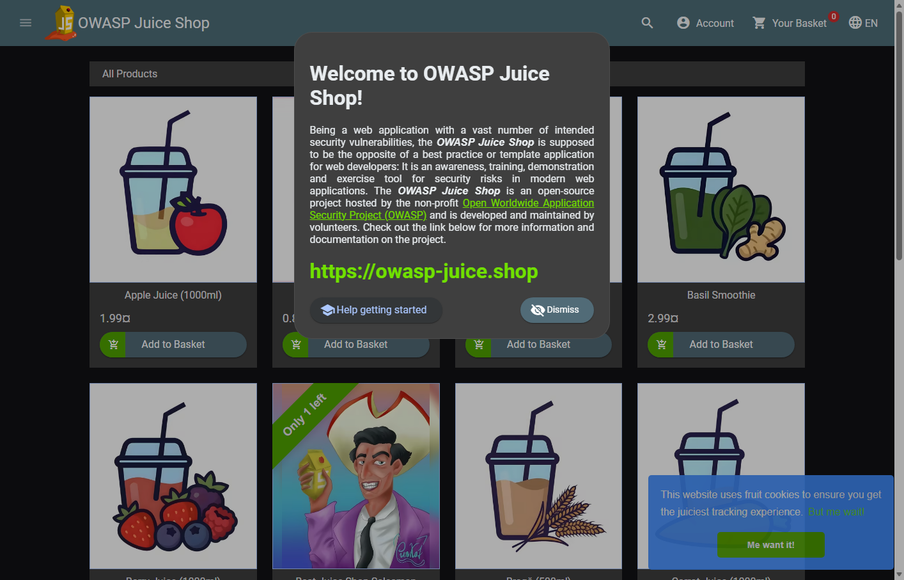

# Bằng chứng Bài 1

Thu ngày **26/10/2026**, múi giờ người dùng **Asia/Bangkok (UTC+07:00)**. JSON runtime dùng offset `+07:00`; timestamp Nginx và trình duyệt có thể là UTC (`Z` hoặc `+0000`). Tất cả kết quả dưới đây đến từ môi trường Docker thực tế trên máy này.

## Nghiệm thu

| ID | Kết quả | Bằng chứng |
|---|---|---|
| L1-01 | PASS — Compose hợp lệ, exit 0 | [compose-check.txt](compose-check.txt) |
| L1-02 | PASS — hai container running, cổng host chỉ bind 127.0.0.1; WAF healthy | [runtime.json](runtime.json), [compose-check.txt](compose-check.txt) |
| L1-03 | PASS — hai HTML 200, tám asset JS/CSS giống nhau, trang sản phẩm render ở hai cổng | [backend-check.json](backend-check.json), [waf-check.json](waf-check.json), [assets-check.json](assets-check.json), [browser-check.json](browser-check.json), hai ảnh bên dưới |
| L1-04 | PASS — module, engine On, CRS và blocking paranoia 1 trong cấu hình đã nạp | [waf-config.txt](waf-config.txt) |
| L1-05 | PASS — proxy backend đúng, đọc được startup/access log | [waf-config.txt](waf-config.txt), [waf-logs.txt](waf-logs.txt) |
| L1-06 | PASS — phiên bản/tag/digest thực tế được ghi; cả hai image khóa digest trong Compose | [runtime.json](runtime.json), [docker-compose.yml](../../docker-compose.yml) |

L1-03 đánh giá khả năng truy cập trang sản phẩm; không khẳng định mọi chức năng Juice Shop hoạt động qua CRS mặc định. Socket.IO polling có giới hạn được ghi riêng bên dưới.

## Giao diện thực tế

Edge headless dùng profile tạm riêng, không đăng nhập. CDP đọc tiêu đề, URL, nội dung `app-root`, đợi ảnh sản phẩm tải rồi chụp PNG trực tiếp. `browser-check.json` ghi kết quả và phiên bản trình duyệt. Ảnh là viewport trang, không có thanh địa chỉ; URL được ghi bằng CDP trong JSON.

### Trực tiếp cổng 3000



### Qua WAF cổng 8080


## Phương pháp thu và kiểm tra lại

| File | Phương pháp |
|---|---|
| `backend-check.json`, `waf-check.json` | `Invoke-WebRequest -UseBasicParsing` đến `/`; kiểm tra 200, HTML, title và `app-root`; lấy mapping/image bằng Docker inspect |
| `assets-check.json` | Lấy các đường dẫn `.js`/`.css` từ HTML, loại trùng; GET từng đường qua cả hai cổng, kiểm tra status/type/độ dài, so SHA256 nội dung |
| `runtime.json` | `docker version --format '{{json .}}'`, `docker compose version`, `docker inspect`, `docker image inspect`, `nginx -v`, thông tin cấu hình đã trích |
| `waf-config.txt` | Trích các dòng liên quan từ `nginx -T`; đọc setup, ModSecurity và CRS config; kiểm tra symlink log bằng `ls -l` |
| `waf-logs.txt` | Đọc Compose logs, chỉ giữ startup/config và access GET `/` thành công; bỏ query Socket.IO, cookie và dữ liệu phiên |
| `compose-check.txt` | Compose validation, trạng thái service/container thực tế |
| `readiness-checks.json` | Parse script bằng PowerShell parser và chạy script bằng Windows PowerShell 5.1 trong ba trường hợp bên dưới |
| `browser-check.json`, PNG | Edge headless với profile tạm; CDP `Runtime.evaluate`, `Page.captureScreenshot`; không thao tác đăng nhập |
| `browser-observation.json` | Rút gọn audit JSON của POST Socket.IO do trình duyệt tự gửi; bỏ headers, body, query và session ID |

Các lệnh chính để kiểm tra lại từ thư mục repository:

```powershell
docker compose config --quiet
docker compose up -d
powershell.exe -NoProfile -File scripts/Wait-LabReady.ps1 -TimeoutSeconds 120
docker compose ps
docker compose exec -T waf nginx -T
docker compose exec -T waf cat /etc/modsecurity.d/setup.conf
docker compose exec -T waf cat /etc/modsecurity.d/modsecurity.conf
docker compose exec -T waf cat /opt/owasp-crs/crs-setup.conf
docker compose logs --no-color --tail 100 waf
```

## Kiểm tra script readiness

| Trường hợp | Kết quả mong đợi và thực tế |
|---|---|
| Cả hai endpoint Juice Shop đang chạy | Exit 0 — PASS |
| Đặt WafUrl thành `http://127.0.0.1:8080/healthz`, HTTP 200 nhưng không phải HTML Juice Shop | Exit 1 sau deadline 4 giây — PASS |
| Đặt WafUrl thành cổng không lắng nghe `http://127.0.0.1:49123/` | Exit 1 sau deadline 4 giây — PASS |

Lệnh, đầu ra, exit code và thời gian đo được lưu trong `readiness-checks.json`. Thời gian tiến trình có thêm khoảng khởi động PowerShell. Các probe này không thực hiện bài kiểm thử tấn công.

## Giới hạn và thay đổi môi trường

- Kết quả kiểm thử SQL Injection và đăng nhập được trình bày trong [báo cáo Bài 2](../../docs/lab-report.md).
- Quan sát thật: trình duyệt gửi POST `/socket.io/` dạng `text/plain`; CRS `920420` cộng điểm, `949110` chặn 403. Trang sản phẩm render được nhưng realtime có thể bị ảnh hưởng. Không sửa policy để che hiện tượng; xem `browser-observation.json`.
- Image mặc định có cảnh báo SSL stapling vì chứng chỉ nội bộ; `nginx -T` thành công. Lab dùng HTTP, không publish cổng HTTPS 8443.
- Cổng 8080 từng bị `PEMHTTPD-x64` của EDB PEM chiếm. Người dùng đã dừng dịch vụ bằng quyền quản trị. Dịch vụ được để dừng cho WAF dùng cổng; startup type không đổi. Khi muốn khôi phục: `docker compose down`, rồi `Start-Service -Name PEMHTTPD-x64` trong PowerShell quản trị.
- Các trích đoạn log là lựa chọn từ đầu ra thật, không phải toàn bộ log; dữ liệu cookie và phiên trình duyệt không được đưa vào bằng chứng.
